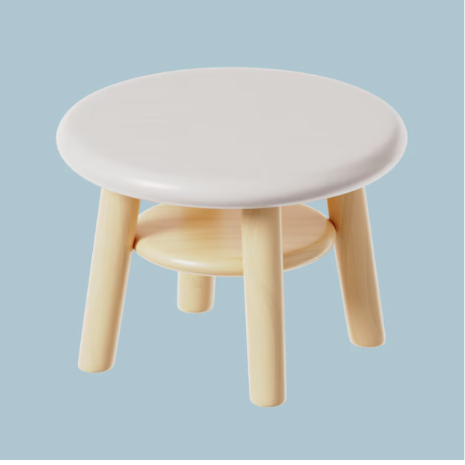

# Canvas Practice

A small practice project for experimenting with the HTML `<canvas>` element. It includes 2D drawing, a simple first-person view, and 3D scenes drawn with WebGL. The graphics are written directly with browser canvas and WebGL APIs; no graphics library is used.

## Experiments

- **2D shapes:** a rectangle with a color button, a circle, and a rounded white cube over a background image.
- **2D first-person camera:** a ray-cast scene with movement and turning.
- **WebGL first-person camera:** a 3D scene with movement, turning, and looking up or down.
- **3D table:** an interactive model based on the reference image below, with a glass of water on top. Drag to rotate it, and use the buttons to zoom or reset the view.



## Run locally

Install dependencies with [pnpm](https://pnpm.io/), then start the development server:

```bash
pnpm install
pnpm dev
```

Open [http://localhost:3000](http://localhost:3000).

For the first-person scenes, click the canvas before using the keyboard. Use **W/S** to move forward and back, **A/D** to strafe, and **←/→** to turn. In the WebGL scene, **↑/↓** also tilts the camera. On a phone, use the controls below each scene.

This repository is for learning and trying different canvas features, so the experiments may change over time.
